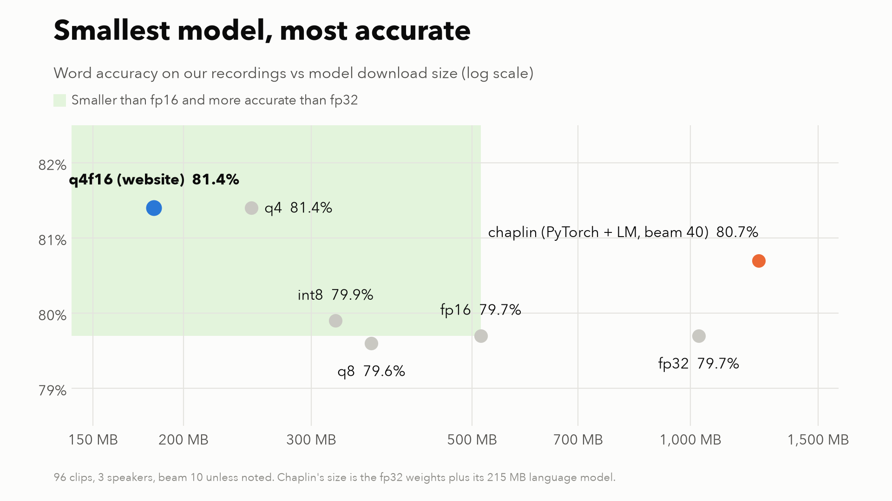

# Lipscribe

Lipscribe reads your lips through the webcam and turns them into text, then speech. The model runs in your browser. Video never leaves the computer.

It uses the pretrained Auto-AVSR lip-reading model, exported to ONNX and cut to 182 MB with 4-bit weights. On our own recordings it gets 18.6% word error rate.

<picture>
  <source media="(prefers-color-scheme: dark)" srcset="ml/results/charts/dark/3_size_vs_accuracy.png">
  
</picture>

More results in [`ml/README.md`](ml/README.md#results).

## Quick start

Needs Node.js 20+ and [uv](https://github.com/astral-sh/uv).

```sh
cd ml
uv sync
bash scripts/download.sh
uv run python scripts/export_onnx.py
uv run python scripts/export_onnx.py --precision fp16
uv run python scripts/quantize.py
uv run python scripts/package_web.py
cd ../web && npm run dev
```

Open http://localhost:3000/demo and allow the camera.

## Layout

| Folder | |
|---|---|
| [`web/`](web/README.md) | Website and in-browser demo |
| [`desktop/`](desktop/README.md) | Electron app with the model built in and a virtual microphone for calls |
| [`ml/`](ml/README.md) | Model export, quantization, evaluation, test recordings |

Model weights, datasets and exports are not committed. The scripts in `ml/` download or build them.

## AI disclosure

We used [Claude](https://claude.ai) (Anthropic) to help write the code, docs and charts in this repo. The lip-reading model is the pretrained Auto-AVSR model, not something Claude made. The accuracy numbers come from our own test recordings.
