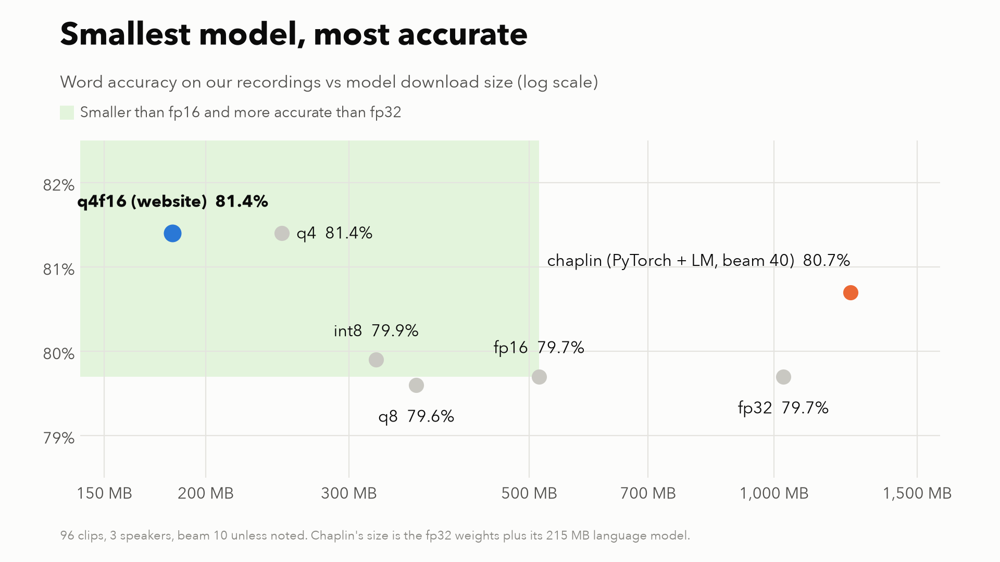
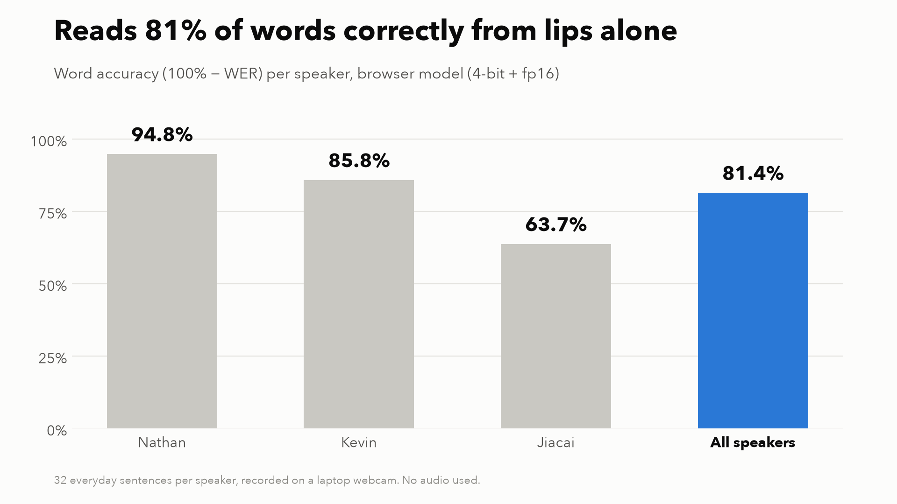
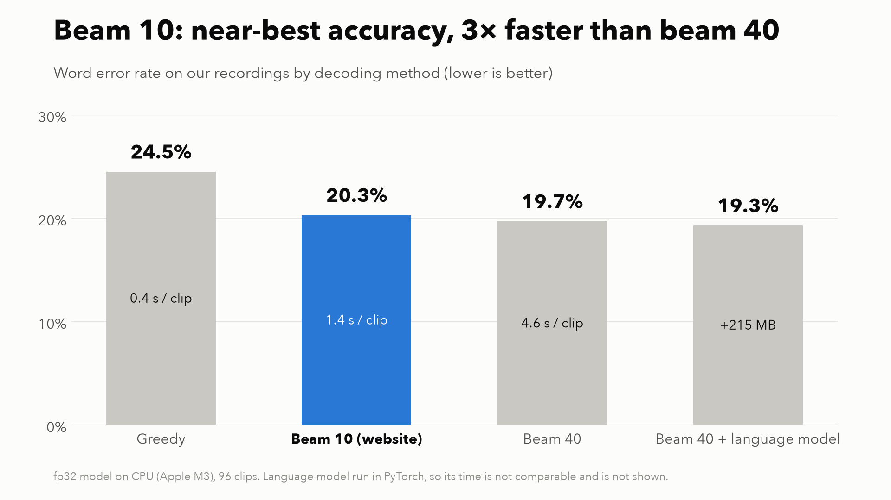

# Lipscribe ML

Export, quantize and evaluate the lip-reading model the website runs.

The model is the pretrained Auto-AVSR visual speech recognizer (LRS3, 19.1% WER on its test set), the same one [chaplin](https://github.com/amanvirparhar/chaplin) uses. Chaplin's model code is vendored in `third_party/chaplin/` (MIT, espnet parts Apache 2.0).

## Setup

Needs [uv](https://github.com/astral-sh/uv).

```sh
uv sync
bash scripts/download.sh                              # ~1.2 GB weights, ~0.9 GB GRID (2 speakers)
uv run python scripts/prepare_grid.py --per-speaker 50
```

## Pipeline

```sh
uv run python scripts/export_onnx.py                    # exports/fp32
uv run python scripts/export_onnx.py --precision fp16   # exports/fp16
uv run python scripts/quantize.py                       # exports/{int8,q8,q4,q4f16}
uv run python scripts/package_web.py                    # exports/web, served at /models/
CLOUDFLARE_API_TOKEN=... uv run scripts/upload_r2.py    # publish exports/web for the deployed site
uv run python scripts/evaluate.py --datasets grid,recordings \
  --variants torch_lm,torch,fp32_b40,fp32_b10,fp32_greedy,fp16_b10,int8_b10,q8_b10,q4_b10,q4f16_b10
uv run python scripts/make_charts.py                    # results/charts/{light,dark}/*.png
```

## Results

<picture>
  <source media="(prefers-color-scheme: dark)" srcset="results/charts/dark/3_size_vs_accuracy.png">
  
</picture>

<picture>
  <source media="(prefers-color-scheme: dark)" srcset="results/charts/dark/2_accuracy_per_speaker.png">
  
</picture>

<picture>
  <source media="(prefers-color-scheme: dark)" srcset="results/charts/dark/4_decoding.png">
  
</picture>

Measured 2026-11-14 on an Apple M3 CPU with ONNX Runtime. "Changed" is the word difference from fp32 beam 40. Full tables are in `results/recordings.md` and `results/grid.md`.

| Variant | Size | WER ours (3 speakers, 96 clips) | WER GRID (100 clips) | Changed (ours / GRID) |
|---|---|---|---|---|
| PyTorch + LM, beam 40 (chaplin) | - | 19.3% | 78.5% | 10.5% / 39.0% |
| PyTorch, beam 40 | - | 19.7% | 72.8% | 0% / 0% |
| fp32 ONNX, beam 40 | 1027 MB | 19.7% | 72.8% | - |
| fp32, beam 10 | 1027 MB | 20.3% | 73.8% | 0.9% / 4.7% |
| fp32, CTC greedy | 1027 MB | 24.5% | 66.0% | 17.3% / 42.1% |
| fp16, beam 10 | 514 MB | 20.3% | 73.7% | 0.9% / 4.5% |
| int8, beam 10 | 324 MB | 20.1% | 74.2% | 3.6% / 10.5% |
| q8, beam 10 | 363 MB | 20.4% | 73.7% | 1.1% / 5.0% |
| q4, beam 10 | 248 MB | 18.6% | 75.0% | 6.4% / 25.9% |
| **q4f16, beam 10** | **182 MB** | **18.6%** | **75.2%** | 6.6% / 25.3% |

The website uses q4f16, beam 10, no language model.

- ONNX plus `decode.py` matches PyTorch + espnet exactly. Transcripts are identical on all 196 clips.
- fp16 is lossless. 4-bit costs at most 1.4 WER points on GRID and nothing measurable on our recordings, but it changes more outputs on hard clips.
- The 215 MB language model barely helps on natural speech (19.3% vs 19.7%) and hurts on GRID.
- GRID sentences follow a fixed odd grammar ("bin blue at f two now") far from the TED training data. Every variant scores badly. Use GRID only to compare variants.
- The table uses OpenCV LMEDS face alignment, like chaplin. We switched to a closed-form least-squares fit so the browser can reproduce it exactly. WER is unchanged (`results/*_lstsq.md`).
- The browser port in `web/public/js/lipread/` matches this pipeline. Mouth crops agree within 1 grey level, and 30/30 transcripts match with onnxruntime-web (WASM). Run `npm test` in `web/` after `scripts/dump_parity.py`.

## Recording test clips

Everyone records the same 32 sentences from `data/recordings/prompts.csv` under their own name. Clips go to `data/recordings/clips/<speaker>/<id>.mp4` and are never committed, since they show faces.

```sh
uv run python tools/record_prompts.py --speaker alex
```

Press SPACE, say the sentence at normal speed, press SPACE again. R redoes the current clip, N/B skip forward and back, Q quits. Run the same command later to pick up where you stopped.

Face the camera with light in front of you, whole face in frame, about an arm's length away. Leave half a second of silence before and after each sentence.

`evaluate.py --datasets recordings` reports WER per speaker and combined. `--datasets recordings/alex` uses one speaker.

## Layout

| Path | |
|---|---|
| `lipscribe_ml/model.py` | Load the PyTorch model, ONNX wrappers for encoder and decoder step |
| `lipscribe_ml/preprocess.py` | Video to 88x88 mouth crops (face detection, target tracking, 25 fps, alignment) |
| `lipscribe_ml/decode.py` | Beam search (attention + CTC prefix score) and CTC greedy in NumPy, written to port to JS |
| `scripts/download.sh` | Weights and GRID data, resumes broken downloads |
| `scripts/export_onnx.py` | ONNX export, checked against PyTorch |
| `scripts/quantize.py` | int8, q8, q4 and q4f16 builds |
| `scripts/prepare_grid.py` | Fixed GRID subset and transcripts |
| `scripts/evaluate.py` | WER per variant, writes `results/<name>.{json,md}` |
| `scripts/make_charts.py` | Presentation charts from `results/*.md` |
| `scripts/package_web.py` | q4f16 + q4 models, tokens and crop constants for the website |
| `scripts/upload_r2.py` | Upload `exports/web/` to the public R2 bucket |
| `scripts/dump_parity.py` | Fixtures for `web/test/` |
| `tools/record_prompts.py` | Webcam recorder for labeled clips |
| `tests/` | Tracking tests, including a repro of chaplin's face-switching bug |

Not committed: `models/`, `exports/`, `data/grid/`, `data/recordings/clips/`, `results/cache/`, `results/parity/`.

## Tests

```sh
uv run python tests/test_tracking.py
```
